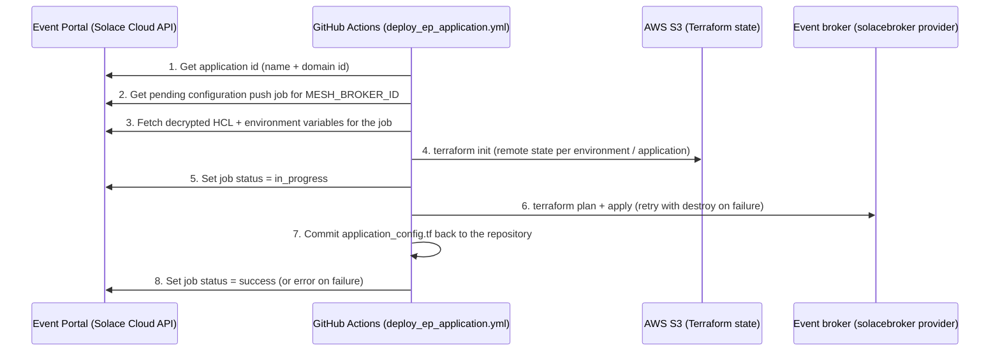

# ep-self-managed-promotion

GitHub Actions automation for **Solace Event Portal self-managed promotion** and for **backing up Solace Cloud
services and event brokers**.

The repository does four things:

1. **Deploys Event Portal applications** to event brokers. When an application is promoted in Event Portal, a
   configuration push job is created. A GitHub Actions workflow fetches that job's Terraform (HCL) configuration,
   applies it to the target broker and reports the result back to Event Portal.
2. **Backs up the broker CLI configuration** (whole broker and individual Message VPNs) to the repository every day.
3. **Backs up the Solace Cloud services** themselves, as Terraform files with `import` blocks, so the services can
   be adopted into Terraform state or recreated.
4. **Bootstraps the S3 bucket** that stores every Terraform state file.

Contents

- [How it works](#how-it-works)
- [Repository structure](#repository-structure)
- [Workflows](#workflows)
- [Requirements](#requirements)
- [Configuration reference](#configuration-reference)
- [Setup guide](#setup-guide)
- [Running the workflows](#running-the-workflows)
- [Terraform state and backend](#terraform-state-and-backend)
- [Local development](#local-development)
- [Related documentation](#related-documentation)

---

## How it works

### Event Portal self-managed promotion

Event Portal supports a **Self-Managed** CI/CD mode: promoting an application creates a configuration push job but
does **not** push it. The pipeline in this repository takes over from there.



Step by step (all calls use `SOLACE_CLOUD_API_BASE = https://api.solace.cloud/api/v2/architecture`):

| # | Step | API / action |
|---|------|--------------|
| 1 | **Get Application ID** | `GET /applications?name=<app>&applicationDomainId=<domain>`, takes `.data[0].id` |
| 2 | **Get Configuration Push Job ID** | `GET /runtimeManagement/applications/<appId>/configurationPushJobs?pageSize=100&pageNumber=1&statuses=pending`, selects the first job whose `eventBrokerId` equals `MESH_BROKER_ID`. If there is none the workflow stops with exit code 2. |
| 3 | **Fetch Terraform HCL Config** | `GET /runtimeManagement/applicationConfigurationPushJobs/<jobId>/decryptedConfigurations?format=hcl`. The HCL goes to `application_config.tf`. Each entry of `.data.environmentVariables` is exported to `$GITHUB_ENV` as `TF_VAR_<key>`. |
| 4 | **Terraform Init** | Initialises the S3 backend (`bucket`, `key` and `region` are passed with `-backend-config`). |
| 5 | **Generate Terraform Plan and Apply** | Marks the job `in_progress`, then runs plan + apply with the retry logic described below. |
| 6 | **Commit and push** | Commits `application_config.tf` and the `.gitignore` to the repo (never state or `.terraform`). |
| 7 | **Mark job complete / failed** | `PUT .../applicationConfigurationPushJobs/<jobId>/status` with `success` or `error`. |

#### Terraform plan/apply retry behaviour

The **Generate Terraform Plan and Apply** step runs `terraform plan -out=tfplan` followed by `terraform apply tfplan` in a loop:

1. If plan **and** apply succeed, the step ends.
2. If either fails, the step runs `terraform destroy -auto-approve`, then tries again.
3. After the last allowed retry fails (and its destroy runs), the step fails and the job is marked `error` in
   Event Portal.
4. If `terraform destroy` itself fails, the step stops immediately without further retries.

The number of **retries** (not counting the first attempt) is resolved in this order:

1. the `max_retries` workflow input (defaults to `3` when you start the workflow manually),
2. the `TF_APPLY_MAX_RETRIES` repository/environment variable, used only when the input is left blank,
3. the built-in default of `3`.

The value must be a non-negative integer (`0` means one attempt and no retries).

> `terraform destroy` removes **everything in that application's Terraform state**, not only the failed change.

### Backups

| Workflow | What is backed up | Where it is stored |
|----------|-------------------|--------------------|
| Backup Cloud Broker (CLI) | Whole broker: `show current-config all redact` | `solace/<env>/broker.cli` |
| Backup Message Vpns (CLI) | One Message VPN: `show current-config message-vpn <vpn> redact` | `solace/<env>/message-vpn/<vpn>/<vpn>.cli` |
| Backup Solace Cloud Services | Solace Cloud services, connection endpoints and DNS names as Terraform | `solace/cloud/*.tf` |

The CLI backups connect over SSH with a **read-only** SEMP user (see [scripts/README.md](scripts/README.md)). The
cloud backup calls the Solace Cloud REST APIs, generates Terraform and imports the services into the Terraform state.
See [solace/README.md](solace/README.md) for the layout of the generated files.

---

## Repository structure

```
ep-self-managed-promotion/
├── README.md                          This file
├── LICENSE                            Apache 2.0
├── .gitignore                         Ignores .idea and the local S3-bootstrap Terraform files
│
├── .github/workflows/
│   ├── deploy_ep_application.yml      Deploy an Event Portal application to a broker (manual)
│   ├── backup_broker.yaml             Nightly CLI backup of whole brokers
│   ├── backup_message_vpn.yaml        Nightly CLI backup of individual Message VPNs
│   ├── backup_cloud.yaml              Nightly backup of Solace Cloud services as Terraform
│   └── create_tfstate_s3_bucket.yaml  One-off creation of the Terraform state bucket (manual)
│
├── scripts/                           Python scripts used by the workflows
│   ├── README.md                      Detailed script documentation
│   ├── solace_batch_cli_execution.py  SSH/CLI broker backup
│   ├── solace_generate_cloud_backup.py  Solace Cloud services -> Terraform generator
│   ├── requirements.txt               Python dependencies used by CI
│   └── mission-control.json           OpenAPI spec of the Mission Control API (reference only)
│
├── solace/                            Everything generated or deployed by the workflows
│   ├── README.md                      Detailed description of this folder
│   ├── cloud/                         Terraform for the Solace Cloud services
│   ├── development/                   Backups + deployed applications for "development"
│   └── test/                          Backups + deployed applications for "test"
│
├── terraform/                         Shared files copied into every deployment folder
│   ├── terraform-backend.tf           Partial S3 backend configuration
│   └── .gitignore                     Keeps state, plans, tfvars and .terraform out of git
│
└── s3-bucket-creation/                Terraform that creates the S3 state bucket
    ├── s3-bucket.tf                   Bucket + versioning + encryption + public-access block
    └── policy.txt                     IAM policy needed to use the bucket
```

---

## Workflows

All third-party actions are pinned to full commit SHAs.

| Workflow file | Name | Trigger | Environment | Purpose |
|---------------|------|---------|-------------|---------|
| `deploy_ep_application.yml` | Deploy Event Portal Application | Manual (`workflow_dispatch`) | `development` or `test` (input) | Fetch and apply an Event Portal configuration push job |
| `backup_broker.yaml` | Backup Cloud Broker (CLI) | Daily 22:10 `America/New_York` + manual | matrix: `development`, `test` | Whole-broker CLI backup |
| `backup_message_vpn.yaml` | Backup Message Vpns (CLI) | Daily 22:00 `America/New_York` + manual | matrix: `development`, `test` x VPN `sandbox` | Per-VPN CLI backup |
| `backup_cloud.yaml` | Backup Solace Cloud Services | Daily 21:50 `America/New_York` + manual | none (repository-level secrets/variables) | Cloud services as Terraform + import into state |
| `create_tfstate_s3_bucket.yaml` | Create tfstate AWS - S3 bucket | Manual | none | Create the state bucket |

`production` is present as a commented-out option in the deploy workflow's input list and in both backup matrices.

### `deploy_ep_application.yml`

Inputs:

| Input | Required | Default | Description |
|-------|----------|---------|-------------|
| `environment` | yes | `development` | `development` or `test`. Selects the GitHub Environment (its secrets and variables) and the folder under `solace/`. |
| `application_name` | yes | `EmployeeLifecycleManager` | Application name in Event Portal. Also used as the folder name and in the state key. |
| `application_domain_id` | yes | `3j896ggpxon` | Event Portal Application Domain ID the application belongs to. |
| `max_retries` | no | `3` | Retries of plan/apply after a failure (see [retry behaviour](#terraform-apply-retry-behaviour)). |

Job settings worth knowing:

- Runs on `ubuntu-latest` in the GitHub Environment `inputs.environment`.
- `concurrency: group: ci-solace-ep-deployment`, `cancel-in-progress: false`, so runs are serialised.
- `permissions: id-token: write, contents: write` (OIDC to AWS, and committing back to the repo).
- Environment variables set for the whole job: `TF_LOG=DEBUG` (very verbose logs), `SOLACEBROKER_RETRIES=1`,
  `SOLACEBROKER_REQUEST_TIMEOUT_DURATION=10m`.
- The working folder is `./solace/<environment>/<application_name>/`. It is created at run time and receives a copy
  of `terraform/terraform-backend.tf` and `terraform/.gitignore`.
- Debug steps (OIDC claims, AWS identity, dump of `GITHUB_ENV`, HCL listing) only run when the variable
  `ACTIONS_STEP_DEBUG` is `true`.

### `backup_broker.yaml` and `backup_message_vpn.yaml`

Both install `scripts/requirements.txt`, run `scripts/solace_batch_cli_execution.py`, check the result and commit it.

1. The script writes `output.cli` and `output.err.cli` inside `scripts/`.
2. The step fails if `output.cli` is missing or empty, or if `output.err.cli` is not empty.
3. The files are moved into `solace/<env>/` (broker backup) or `solace/<env>/message-vpn/<vpn>/` (VPN backup).
4. Changes are committed as `github-actions[bot]` with the message `Update generated backup files`.

The matrix runs one job at a time (`max-parallel: 1`, `fail-fast: false`).

### `backup_cloud.yaml`

1. Installs Python dependencies and Terraform.
2. Runs `python solace_generate_cloud_backup.py --services="$SOLACE_CLOUD_SERVICES" --repo-root=./../ $SOLACE_CLOUD_IS_PUBLIC_FLAG`
   from `scripts/`, which writes `solace/cloud/provider.tf` (only if missing) and one
   `solacecloud_service.<name>.tf` per service.
3. Authenticates to AWS with OIDC.
4. `terraform init` with the S3 backend, key `solace/cloud/terraform.tfstate`.
5. `terraform plan` and `terraform apply`. The generated `import` blocks adopt the existing services into state.
6. Commits `*.tf` back to the repository (state files and `.terraform` are removed from the index).

### `create_tfstate_s3_bucket.yaml`

Runs `terraform init`, `plan` and `apply` using `AWS_ACCESS_KEY_ID` and `AWS_SECRET_ACCESS_KEY` secrets. Its
`working-directory` is `./terraform/s3-bucket`. The bucket definition itself is in `s3-bucket-creation/s3-bucket.tf`.

---

## Requirements

### Accounts and services

| Requirement | Used for |
|-------------|----------|
| **Solace Cloud account** with Event Portal | Application promotion, Mission Control APIs |
| **Event Portal environment set to Self-Managed** runtime configuration | Makes a promotion create a push job without pushing it |
| **Solace Cloud API token** | All Solace Cloud REST calls (see [permissions](#solace-cloud-api-token-permissions)) |
| **Event broker(s)** reachable from GitHub runners | Target of deployments; SSH (CLI) access for backups |
| **Read-only SEMP/CLI user** on each broker | CLI backups |
| **AWS account** with an S3 bucket | Terraform remote state |
| **AWS IAM role trusted by GitHub OIDC** | Lets workflows reach S3 without long-lived keys |
| **GitHub repository** with Environments `development` and `test` | Scoped secrets and variables |

### Tooling

| Tool | Version | Notes |
|------|---------|-------|
| Terraform | **1.10 or newer** | The backend uses S3-native locking (`use_lockfile = true`). `import` blocks need 1.5+. `setup-terraform` installs it in CI. |
| Python | 3.12 in CI | The scripts use only standard-library features plus the packages below. |
| Terraform providers | `solaceproducts/solacecloud`, `solaceproducts/solacebroker`, `hashicorp/aws ~> 5.0` | Downloaded by `terraform init`. |

### Python packages (`scripts/requirements.txt`)

| Package | Version |
|---------|---------|
| bcrypt | 5.0.0 |
| cffi | 2.1.1 |
| cryptography | 50.0.2 |
| invoke | 3.0.3 |
| paramiko | 5.1.0 |
| pycparser | 3.12 |
| PyNaCl | 1.6.2 |
| requests | 2.32.3 |

`paramiko` (SSH) is needed by the CLI backup script, `requests` by the cloud backup generator. The others are
dependencies of paramiko or are pinned for reproducible builds.

### Solace Cloud API token permissions

Create the token in Solace Cloud and store it as `SOLACE_CLOUD_API_TOKEN`. The deployment workflow needs:

| Action | Required permission |
|--------|---------------------|
| Get application / push job ids | `application:get:*` |
| Run a push job (on-demand mode) | `application_configuration_push_job:run:*` |
| Fetch Terraform HCL config | `application_configuration_push_job:*:*` |
| Update push job status | `application_configuration_push_job:update_status:*` |

The cloud backup additionally needs permission to read event broker services and environments
(for example `environments:view` for `GET /environments/{id}`) and to read the legacy service details
(`/api/v0/services/{id}`).

---

## Configuration reference

### Secrets

| Secret | Used by | Description |
|--------|---------|-------------|
| `SOLACE_CLOUD_API_TOKEN` | deploy, backup_cloud | Solace Cloud API token. |
| `AWS_ROLE_TO_ASSUME` | deploy, backup_cloud | ARN of the IAM role assumed through GitHub OIDC. |
| `AWS_REGION` | deploy, backup_cloud | AWS region of the state bucket. |
| `AWS_BUCKET_NAME` | deploy, backup_cloud | Name of the S3 bucket that stores Terraform state. |
| `DEPLOYMENT_BROKER_PASSWORD` | deploy | Password of the broker user Terraform uses for the deployment, passed as `TF_VAR_password`. |
| `BACKUP_SOLACE_BROKER_PASSWORD` | backup_broker, backup_message_vpn | Password of the read-only CLI user (`BACKUP_SOLACE_BROKER_USERNAME`). |
| `AWS_ACCESS_KEY_ID` | create_tfstate_s3_bucket | Credentials used once to create the bucket. |
| `AWS_SECRET_ACCESS_KEY` | create_tfstate_s3_bucket | Credentials used once to create the bucket. |

Secrets and variables used by `deploy_ep_application.yml` and the two CLI backups are read from the
**GitHub Environment** (`development` / `test`), so each environment can point to a different broker.

### Variables

| Variable | Used by | Description |
|----------|---------|-------------|
| `DEPLOYMENT_BROKER_URL` | deploy | SEMP URL of the target broker, passed to Terraform as `TF_VAR_url`. |
| `DEPLOYMENT_BROKER_USERNAME` | deploy | Broker user Terraform uses for the deployment, passed as `TF_VAR_username`. |
| `BACKUP_SOLACE_BROKER_HOSTNAME` | backup_broker, backup_message_vpn | Broker hostname for SSH/CLI. |
| `BACKUP_SOLACE_BROKER_PORT` | backup_broker, backup_message_vpn | SSH port. |
| `BACKUP_SOLACE_BROKER_USERNAME` | backup_broker, backup_message_vpn | Read-only CLI user. |
| `MESH_BROKER_ID` | deploy | Event Portal id of the event broker (mesh) whose pending push job should be applied. |
| `TF_APPLY_MAX_RETRIES` | deploy | Optional. Retry count used when the `max_retries` input is blank. |
| `ACTIONS_STEP_DEBUG` | all | Set to `true` to print extra debugging output (also exposes configuration contents in logs). |
| `SOLACE_CLOUD_SERVICES` | backup_cloud | Comma-separated service names to back up. Empty means every service in the account. |
| `SOLACE_CLOUD_IS_PUBLIC_FLAG` | backup_cloud | Extra argument appended to the generator command. Set to `--public` when the services are in a public region, leave empty otherwise. |

### Terraform variables injected at run time

| Variable | Source |
|----------|--------|
| `TF_VAR_url`, `TF_VAR_username` | `DEPLOYMENT_BROKER_URL`, `DEPLOYMENT_BROKER_USERNAME` variables |
| `TF_VAR_password` | `DEPLOYMENT_BROKER_PASSWORD` secret |
| `TF_VAR_<name>` | One per entry in `environmentVariables` of the push job response (written to `$GITHUB_ENV`) |
| `SOLACECLOUD_API_TOKEN` | Read by the `solacecloud` Terraform provider and by the generator script |

---

## Setup guide

1. **Configure Event Portal.** In Solace Cloud set the runtime configuration option of each environment to
   **Self-Managed**. See *Setting Event Portal Runtime Configuration Options* in the Solace documentation.
2. **Create the API token** with the permissions listed above.
3. **Create the state bucket.** Either run the `Create tfstate AWS - S3 bucket` workflow, or apply
   `s3-bucket-creation/s3-bucket.tf` yourself. The bucket has versioning, AES256 encryption and all public access
   blocked, and `prevent_destroy` set. `s3-bucket-creation/policy.txt` is the IAM policy (Get/Put/Delete object and
   List bucket) that identities using the bucket need.
4. **Configure AWS OIDC.** Create an IAM role that trusts GitHub's OIDC provider for this repository and has the
   bucket policy attached. Store its ARN as `AWS_ROLE_TO_ASSUME`.
5. **Create the GitHub Environments** `development` and `test` and add the secrets and variables listed above.
6. **Add repository-level secrets/variables** for `backup_cloud.yaml` (it does not use an Environment).
7. **Run** the workflows manually once (see below) before relying on the schedules.

---

## Running the workflows

### Deploy an Event Portal application

1. Promote the application in Event Portal so a push job exists in `pending` status for your broker.
2. In GitHub go to **Actions -> Deploy Event Portal Application -> Run workflow**.
3. Choose the environment, enter the application name and the application domain id, optionally change `max_retries`.
4. Follow the run. On success `solace/<environment>/<application>/application_config.tf` is updated in the
   repository and the job is marked `success` in Event Portal.

With the GitHub CLI:

```bash
gh workflow run deploy_ep_application.yml \
  -f environment=development \
  -f application_name=EmployeeLifecycleManager \
  -f application_domain_id=3j896ggpxon \
  -f max_retries=3
```

### Run a backup manually

```bash
gh workflow run backup_broker.yaml
gh workflow run backup_message_vpn.yaml
gh workflow run backup_cloud.yaml
```

### Add a Message VPN or environment to the backups

Edit the `matrix` in `backup_message_vpn.yaml` (`env` and `msg-vpn` lists) or in `backup_broker.yaml` (`env`).

---

## Terraform state and backend

`terraform/terraform-backend.tf` is a **partial** S3 backend configuration:

```hcl
terraform {
  backend "s3" {
    encrypt      = true
    use_lockfile = true      # S3-native locking (Terraform 1.10+)
  }
}
```

The bucket, key and region are supplied at `terraform init` time through `-backend-config`, so one file serves every
deployment. State keys:

| Workflow | State key |
|----------|-----------|
| Deploy application | `solace/<environment>/<application_name>/terraform.tfstate` |
| Backup cloud services | `solace/cloud/terraform.tfstate` |

State, plans, `.terraform/` and `*.tfvars` are never committed (`terraform/.gitignore`, copied next to each
configuration).

---

## Local development

```bash
# Python dependencies for the scripts
python -m venv .venv
source .venv/bin/activate            # Windows: .venv\Scripts\activate
pip install -r scripts/requirements.txt
```

- Generate Terraform for your Solace Cloud services: see [scripts/README.md](scripts/README.md).
- Take a CLI backup of a broker: see [scripts/README.md](scripts/README.md).
- Never commit tokens. Pass the Solace Cloud token through the `SOLACECLOUD_API_TOKEN` environment variable.

---

## Related documentation

- [scripts/README.md](scripts/README.md): the two Python scripts, their arguments, APIs and output.
- [solace/README.md](solace/README.md): layout and meaning of the generated and deployed files.
- Solace Terraform providers: `solaceproducts/solacecloud` and `solaceproducts/solacebroker` on the Terraform Registry.
- Solace Cloud REST API reference: https://api.solace.dev/cloud/reference
